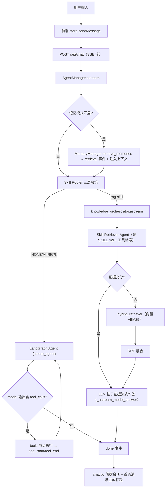

# Skill-First Hybrid RAG — 项目全景文档

> 面向项目成员与二次开发者：从整体框架、核心知识点、到完整工作流，以及每一步在代码中的落点。

---

## 1. 项目概述

这是一个**本地优先、文件即事实源、可审计**的 Agent 工作台。核心目标不是做一个"黑盒"聊天机器人，而是让 Agent 的每一步（记忆召回、知识检索、工具调用、最终回答）都可观察、可解释、可编辑。

设计理念：

1. **本地优先**：不依赖 MySQL / Redis；会话以 JSON 文件落盘，长期记忆使用 PostgreSQL + pgvector（可选，未配置时自动降级为空）；
2. **文件即事实源**：`workspace/`、`knowledge/`、`skills/` 都是可见、可改、可版本管理的文件；
3. **技能可审计**：技能不是写死的函数，而是可读可改的 `SKILL.md`，由 Agent 在运行时读取并执行；
4. **检索可观测**：前端把"Skill 检索 → 降级 → 向量/BM25 召回 → 证据融合"完整展示出来。

### 技术栈

| 层 | 技术 |
| --- | --- |
| 后端 | Python 3.10+、FastAPI、Uvicorn、LangChain 1.x（底层 LangGraph）、LlamaIndex、httpx、tiktoken |
| 模型 | OpenAI-compatible API：zhipu / bailian / deepseek / openai 可切换；embedding 默认用本地 sentence-transformers（BAAI/bge-small-zh-v1.5） |
| 存储 | 会话 `backend/sessions/*.json`；长期记忆 PostgreSQL + pgvector（`memories` 表） |
| 前端 | Next.js 14、React 18、TypeScript、Tailwind CSS、Monaco Editor、react-markdown |
| 评测 | Ragas、FAQ 检索/准确率评估脚本 |

---

## 2. 项目框架

### 2.1 目录结构

```text
Skill-First-Hybrid-RAG/
├─ backend/                         # 后端（Python）
│  ├─ app.py                        # FastAPI 入口：lifespan 初始化 + 路由注册
│  ├─ config.py                     # 多 Provider 配置、运行时 RAG 开关
│  ├─ api/                          # HTTP 接口层
│  │  ├─ chat.py                    # 聊天 SSE 流式接口（消费 astream 事件）
│  │  ├─ sessions.py                # 会话 CRUD / 标题生成
│  │  ├─ files.py                   # 白名单文件读写（Skills/Workspace/Knowledge）
│  │  ├─ memories.py                # 长期记忆 CRUD + 语义检索
│  │  ├─ tokens.py                  # tiktoken token 统计
│  │  ├─ compress.py                # 会话压缩
│  │  ├─ config_api.py              # RAG / Memory 模式开关
│  │  └─ knowledge_index.py         # 知识索引状态 / 重建
│  ├─ graph/                        # Agent 核心逻辑
│  │  ├─ agent.py                   # AgentManager：astream 主入口
│  │  ├─ prompt_builder.py          # 系统提示词多文件组装
│  │  ├─ session_manager.py         # 会话 JSON 持久化、压缩归档
│  ├─ memory/                       # 长期记忆：MemoryManager + pgvector Repository + schema.sql
│  ├─ knowledge_retrieval/          # 知识检索链路（本项目核心）
│  │  ├─ types.py                   # Evidence / RetrievalStep / 结果契约
│  │  ├─ skill_retriever_agent.py   # Skill 检索 Agent（LangGraph）
│  │  ├─ indexer.py                 # md/json 切分 + 向量/BM25 索引
│  │  ├─ hybrid_retriever.py        # 向量 + BM25 并行召回
│  │  ├─ fusion.py                  # RRF 融合 + 去重
│  │  └─ orchestrator.py            # 编排：skill → fallback → fuse
│  ├─ tools/                        # Agent 可用工具
│  │  ├─ terminal_tool.py           # 终端（带危险命令黑名单）
│  │  ├─ read_file_tool.py          # 读文件（防路径穿越）
│  │  ├─ python_repl_tool.py        # Python 代码执行
│  │  ├─ fetch_url_tool.py          # 抓取 URL（HTML→Markdown）
│  │  └─ skills_scanner.py          # 扫描 skills/*/SKILL.md 生成快照
│  ├─ skills/                       # 技能库（每个技能一个 SKILL.md）
│  │  ├─ rag-skill/                 # 知识库检索技能（含 pdf/excel references）
│  │  ├─ web-search/                # 联网搜索
│  │  ├─ get_weather/               # 天气
│  │  └─ retry-lesson-capture/      # 失败经验沉淀
│  ├─ workspace/                    # SOUL / IDENTITY / USER / AGENTS 人格组件
│  ├─ knowledge/                    # 示例知识库（md/json/pdf/xlsx）
│  ├─ sessions/                     # 会话记录 JSON + archive
│  ├─ storage/                      # 知识索引、评测产物
│  ├─ scripts/                      # FAQ 评测脚本
│  └─ SKILLS_SNAPSHOT.md            # 技能快照（运行时注入提示词）
├─ frontend/                        # 前端（Next.js）
│  └─ src/
│     ├─ app/page.tsx               # 三栏工作台：Sidebar | ChatPanel | Inspector
│     ├─ lib/api.ts                 # API 客户端 + SSE 解析器
│     ├─ lib/store.tsx              # 全局状态（会话、消息、流式事件归并）
│     └─ components/
│        ├─ chat/                   # ChatPanel / ChatMessage / RetrievalCard / ThoughtChain / ChatInput
│        ├─ editor/InspectorPanel.tsx # Monaco 在线编辑
│        └─ layout/                 # Navbar / Sidebar / ResizeHandle
└─ docs/knowledge-hybrid-retrieval-ai-plan.md  # 检索链路改造方案
```

### 2.2 分层职责

请求从外到内共四层，每层只做一件事：

```text
前端 UI（Next.js）
   │  SSE 事件流（token / tool_start / tool_end / retrieval / done）
   ▼
API 层（FastAPI，backend/api/chat.py）
   │  把事件转 SSE、把消息/工具/检索记录落盘
   ▼
编排层（AgentManager.astream，backend/graph/agent.py）
   │  Skill Router 三层决策 → Memory RAG / 知识库分支 / 通用 Agent 分支
   ▼
执行层
   ├─ skill_router（L1 指令 / L2 向量+BM25+RRF / L3 轻量 LLM → 技能 ID / NONE）
   ├─ LangGraph Agent（create_agent：model ↔ tools 循环）
   ├─ knowledge_orchestrator（skill → hybrid fallback → RRF）
   └─ 纯 LLM 流式作答（知识库分支）
```

---

## 3. 核心知识点与代码落点

### 3.1 LangGraph Agent（LangChain 1.x `create_agent`）

**知识点**：LangChain 1.x 的 `create_agent` 是预置的 LangGraph 状态机。它内部构建了一个 `StateGraph`：

- 状态：`messages`（带 `add_messages` reducer，消息自动累加）；
- 节点：`model`（绑定工具的 LLM 调用）、`tools`（工具执行）；
- 条件边：`model` 输出包含 `tool_calls` → `tools`，否则 → `END`。

所以一个工具型 Agent 的循环就是标准的 **Tool-calling / ReAct 循环**：`model → tools → model → tools → … → END`。

**项目落点**（`backend/graph/agent.py`）：

```python
def _build_agent(self, extra_instructions=None, tools_override=None):
    system_prompt = build_system_prompt(self.base_dir, runtime_config.get_rag_mode())
    if extra_instructions:
        system_prompt = f"{system_prompt}\n\n" + "\n\n".join(extra_instructions)
    return create_agent(
        model=self._build_chat_model(),
        tools=self.tools if tools_override is None else tools_override,
        system_prompt=system_prompt,
    )
```

项目中一共有两个这样的图：

| 图 | 位置 | 工具 | 职责 |
| --- | --- | --- | --- |
| 主对话 Agent | `agent.py:_build_agent` | terminal / python_repl / fetch_url / read_file | 回答用户、执行任务 |
| Skill 检索 Agent | `skill_retriever_agent.py:astream` | terminal / python_repl / read_file | 只检索知识库，不回答用户，输出结构化 JSON |

### 3.2 异步流式 + SSE（SSE、Async Generator、stream_mode）

**知识点**：`astream` 是异步生成器，用 `async for` 消费大模型流式输出；`stream_mode=["messages", "updates"]` 同时开启两个通道；SSE 协议把每个事件包装成 `event: xxx\ndata: {...}\n\n`。

- `messages` 模式：LLM token 级流，`metadata["langgraph_node"]` 标记来自哪个节点（代码只保留 `model` 节点）；
- `updates` 模式：每个节点执行完后的状态更新，用于还原工具调用。

**项目落点**（`agent.py` 中 LangGraph 流式消费的核心）：

```python
async for mode, payload in agent.astream(
    {"messages": messages},
    stream_mode=["messages", "updates"],
):
    if mode == "messages":
        chunk, metadata = payload
        if metadata.get("langgraph_node") != "model":
            continue
        text = _stringify_content(getattr(chunk, "content", ""))
        if text:
            final_content_parts.append(text)
            yield {"type": "token", "content": text}
        continue

    if mode != "updates":
        continue

    for update in payload.values():
        for agent_message in update.get("messages", []):
            message_type = getattr(agent_message, "type", "")
            tool_calls = getattr(agent_message, "tool_calls", []) or []

            if message_type == "ai" and not tool_calls:
                candidate = _stringify_content(getattr(agent_message, "content", ""))
                if candidate:
                    last_ai_message = candidate

            if tool_calls:
                # 解析工具调用 → yield tool_start，记入 pending_tools
                ...
            if message_type == "tool":
                # 按 tool_call_id 配对 → yield tool_end + new_response
                ...
```

SSE 封装在 `backend/api/chat.py`：

```python
def _sse(event: str, data: dict[str, Any]) -> str:
    return f"event: {event}\ndata: {json.dumps(data, ensure_ascii=False)}\n\n"
```

### 3.3 长期记忆（MemoryManager + pgvector）

**知识点**：长期记忆 = 自动提取候选记忆 → 结构化存储 → 语义检索 → 动态注入 Agent Context。第一阶段只做结构化存储 + 语义检索，不实现自动提取。

**项目落点**：`backend/memory/memory_manager.py`（MemoryManager，与 SessionManager 同级）+ `backend/memory/repository.py`（PostgreSQL/pgvector）+ `backend/memory/schema.sql`。`memories` 表保存 `type`（profile/preference/project/episodic）、`content`、`importance`、`status`（active/inactive）和 `embedding`。检索链路为 query → embedding → pgvector cosine 相似度 → Top-K active memories。

`agent.astream` 在 memory 开关开启时执行召回并把结果作为 assistant 上下文注入（独立于知识库 RAG 开关）：

```python
if memory_mode and self.memory_manager.is_available:
    retrievals = await self.memory_manager.retrieve_memories(
        user_id=self.memory_manager.default_user_id,
        query=message,
        top_k=3,
    )
    if retrievals:
        yield {"type": "retrieval", **self._format_memory_retrieval_step(retrievals)}
    if retrievals:
        augmented_history.append({
            "role": "assistant",
            "content": self._format_retrieval_context(retrievals),
        })
```

### 3.4 Skill-First 检索（Agent 读技能文档干活）

**知识点**：把"如何检索知识库"沉淀为一份可读的 `SKILL.md`，由检索 Agent 运行时读取并按其流程执行（分层索引导航、先学 references 再处理 PDF/Excel、渐进式局部检索、最多 5 轮迭代）。技能即文档，而不是黑盒代码。

**项目落点**：

- `backend/skills/rag-skill/SKILL.md`：完整检索流程，frontmatter 里有 name/description 用于扫描；
- `backend/tools/skills_scanner.py`：扫描 `skills/*/SKILL.md` 生成 `SKILLS_SNAPSHOT.md`，随系统提示词注入；
- `backend/knowledge_retrieval/skill_retriever_agent.py`：强制第一步 `read_file skills/rag-skill/SKILL.md`，只允许本地工具，最终输出**严格 JSON**（status / evidences / narrowed_paths / narrowed_types / rewritten_queries / searched_paths / reason），不是自然语言答案。

### 3.5 混合检索（向量 + BM25）

**知识点**：

- **向量检索**：把文本编码成稠密向量，按余弦/内积相似度召回，擅长语义匹配；
- **BM25**：词法检索，基于词频（TF）、逆文档频率（IDF）和文档长度归一化打分，擅长精确关键词匹配。

**项目落点**：`backend/knowledge_retrieval/indexer.py` 自实现了 BM25（含中英文混合分词：英文按 `[A-Za-z0-9_]+`，中文按单字 + 相邻双字），并持久化向量索引到 `storage/knowledge/vector/`。核心打分逻辑：

```python
idf = math.log(1 + ((corpus_size - df + 0.5) / (df + 0.5)))
denominator = freq + k1 * (1 - b + b * (doc_len / max(1.0, self._avg_doc_length)))
score += idf * ((freq * (k1 + 1)) / max(denominator, 1e-9))
```

`hybrid_retriever.py` 把两条召回并行封装，支持 `path_filters`（skill 收敛的目录）和 `query_hints`（skill 改写后的查询词）：

```python
return HybridRetrievalResult(
    vector_evidences=knowledge_indexer.retrieve_vector(query, top_k=top_k, path_filters=path_filters),
    bm25_evidences=knowledge_indexer.retrieve_bm25(query, top_k=top_k, path_filters=path_filters, query_hints=query_hints),
)
```

### 3.6 RRF 融合（Reciprocal Rank Fusion）

**知识点**：RRF 不比较不同检索器得分（量纲不同无法直接相加），而是对每条证据在每个列表中的**排名**取倒数加权：`score += 1 / (k + rank)`（k 通常取 60）。同时按"路径 + 定位 + 片段"去重。

**项目落点**：`backend/knowledge_retrieval/fusion.py`：

```python
for evidence_list in evidence_lists:
    for rank, evidence in enumerate(evidence_list, start=1):
        key = _dedupe_key(evidence)
        scores[key] = scores.get(key, 0.0) + (1.0 / (rank_constant + rank))
        if key not in representatives:
            representatives[key] = evidence

ranked = sorted(scores.items(), key=lambda item: item[1], reverse=True)
# 取 top_k，channel 标记为 "fused"
```

### 3.7 父子文档切分（Parent-Child Chunking）

**知识点**：检索命中"子块"（小片段，召回精准），展示/回答时回填"父块"（标题及其完整子树，上下文完整），解决"小块丢上下文、大块召回噪声高"的矛盾。

**项目落点**：`indexer.py:_split_markdown` 按标题栈切出 `parent_id = path::标题路径`，块内按空行分段落、超长再按 1200 字符切片，`locator` 保留 `标题路径 / 段落 n`；JSON 按一条问答记录切分。检索时子块命中，`parent_id` 随证据一起返回。

### 3.8 提示词工程（多文件组装 + 运行时 Override）

**知识点**：系统提示词由多个 Markdown 组件实时拼装（人格、身份、用户画像、技能清单、长期记忆），并用显式 override 约束模型"以当次证据为准"。

**项目落点**：`backend/graph/prompt_builder.py`：

```python
SYSTEM_COMPONENTS = (
    ("Skills Snapshot", "SKILLS_SNAPSHOT.md"),
    ("Soul", "workspace/SOUL.md"),
    ("Identity", "workspace/IDENTITY.md"),
    ("User Profile", "workspace/USER.md"),
    ("Agents Guide", "workspace/AGENTS.md"),
)

RUNTIME_OVERRIDE = """<!-- Runtime Override -->
When explicit retrieval evidence is provided for the current request, prioritize that evidence.
Do not assume missing evidence exists elsewhere."""
```

长期记忆不再来自文件，而是在系统提示词末尾固定注入"长期记忆由 MemoryManager 按需检索动态注入，以当次检索片段为准"的说明，实际记忆内容由 `memory_mode` 开关触发检索后注入。

### 3.9 会话管理（文件持久化 + 压缩）

**知识点**：无数据库，会话以 JSON 文件落盘；长会话用"摘要压缩 + 原始消息归档"控制上下文长度。

**项目落点**：`backend/graph/session_manager.py`：

- `sessions/{id}.json` 保存 messages（含 tool_calls、retrieval_steps）；
- `compress_history`：前半段消息写入 `sessions/archive/`，生成摘要存入 `compressed_context`，每次加载时作为 assistant 消息前缀注入；
- `load_session_for_agent` 会把连续的 assistant 消息合并，只保留 user/assistant 角色给模型。

### 3.10 工具层与安全

**知识点**：Agent 工具 = 可被模型调用的函数，但必须做边界控制：命令黑名单、路径穿越防护、超时、输出截断。

**项目落点**（`backend/tools/`）：

- `terminal_tool.py`：黑名单拦截 `rm -rf /`、`shutdown`、`mkfs` 等，30s 超时，输出截断 5000 字符；
- `read_file_tool.py`：`resolve()` 后校验目标必须在项目根目录内；
- `python_repl_tool.py`：子进程 15s 超时；
- `fetch_url_tool.py`：JSON 保留 JSON，HTML 用 html2text 转 Markdown。

### 3.11 可观测性（检索轨迹 + 工具链 + Token 统计）

**知识点**：把检索、工具调用作为一等公民事件流输出，前端可视化，让用户看到"为什么这么回答"。

**项目落点**：

- 后端事件：`retrieval`（含 kind/stage/results）、`tool_start`/`tool_end`、`new_response`、`done`；
- 前端 `RetrievalCard.tsx` 按 stage 渲染 Memory/Skill/Fallback/Vector/BM25/Fused 卡片；`ThoughtChain.tsx` 展示工具输入输出；
- `api/tokens.py` 用 tiktoken 统计系统提示词 + 消息 token。

### 3.12 评测（Ragas）

**知识点**：RAG 系统需要离线指标评估（faithfulness / answer_relevancy / context_precision / context_recall）。

**项目落点**：`backend/scripts/evaluate_faq_*.py` 生成检索结果与 ragas 数据集到 `storage/eval_outputs/`，用于评测 FAQ 路由命中率、检索准确率和 RAG 指标。

---

## 4. 完整工作流

### 4.1 总体流程



### 4.2 一次完整请求的时序

```text
前端 store.sendMessage(message)
  └─ POST /api/chat {message, session_id, stream:true}
      └─ FastAPI StreamingResponse 启动 event_generator()
          └─ agent_manager.astream(message, history)
              ├─ [可选] Memory RAG 召回 → 事件: retrieval(memory)
              ├─ Skill Router 三层决策 → 事件: skill_route（stage/candidates/skill/command）
              │
              ├─ 选中 rag-skill → 知识库分支:
              │   ├─ knowledge_orchestrator.astream(query)
              │   │   ├─ skill_retriever_agent.astream(query)
              │   │   │   └─ LangGraph: model(读 SKILL.md/工具) ↔ tools → skill_result(JSON)
              │   │   ├─ 判断 should_fallback
              │   │   │   └─ hybrid: retrieve_vector + retrieve_bm25 → RRF → fused
              │   │   └─ yield or orchestrated_result
              │   ├─ 事件: retrieval(skill/fallback/vector/bm25/fused)
              │   ├─ 证据注入 augmented_history（assistant 消息）
              │   └─ _astream_model_answer:
              │       └─ LLM.astream → 事件: token... → done
              │
              └─ 通用 Agent 分支:
                  ├─ _build_agent() → create_agent
                  ├─ agent.astream(stream_mode=["messages","updates"])
                  │   ├─ messages → 事件: token
                  │   └─ updates → 事件: tool_start / tool_end / new_response
                  └─ 事件: done

      ← SSE 推给前端: onEvent 归并到消息对象
  └─ 落盘: save_message(user) + save_message(assistant, tool_calls, retrieval_steps)
  └─ 首条消息: generate_title → set_title
```

### 4.3 分支一：通用对话（LangGraph Tool-calling 循环）

1. `_build_messages(history)` 把会话历史转成 `[{role, content}]`，追加当前 user 消息；
2. `create_agent(model, tools, system_prompt)` 编译出 LangGraph 图；
3. `agent.astream(..., stream_mode=["messages", "updates"])` 进入循环：
   - **messages 通道**：`model` 节点输出 token → 转成 `token` 事件（逐字渲染）；
   - 模型决定调用工具 → 状态进入 `tools` 节点 → updates 中出现带 `tool_calls` 的 AI 消息 → `tool_start`；
   - 工具执行完 → updates 中出现 `tool` 消息 → 按 `tool_call_id` 配对 `pending_tools` → `tool_end` + `new_response`（前端开新回复段）；
   - 回到 `model`，继续循环；直到模型输出无工具调用的最终回答。
4. 最后 `done` 事件，内容为空时用最后一条 AI 消息兜底。

对应代码（`agent.py:astream` 通用分支）：

```python
agent = self._build_agent()
messages = self._build_messages(augmented_history)
messages.append({"role": "user", "content": message})

async for mode, payload in agent.astream(
    {"messages": messages},
    stream_mode=["messages", "updates"],
):
    # messages → token 事件；updates → tool_start/tool_end/new_response
    ...

final_content = "".join(final_content_parts).strip() or last_ai_message.strip()
yield {"type": "done", "content": final_content}
```

### 4.4 分支二：知识库查询（Skill-First + Hybrid Fallback）

路由判定：请求进入 `AgentManager.astream` 后，先由三层 Skill Router（`backend/graph/skill_router.py`）决策技能，避免每次都调用路由 LLM：

```text
L1 指令判断层：输入以 "/" 开头 → 按指令处理（/help、/skills、/exit，占位实现），不调用 LLM
L2 混合检索层：sentence-transformers 向量打分 + rank_bm25 词法打分 → RRF 排序
               检索源 = skill 的 name + description + SKILL.md 正文开头几行
               组合分低于阈值（SKILL_ROUTE_THRESHOLD，默认 0.30）视为未命中
L3 轻量 LLM 层：仅在 L2 不确定时调用
               - 3 个候选 → 路由 LLM 三选一
               - 2 个候选 → 路由 LLM 二选一
               - 1 个候选 → 直接采用，不调用 LLM
               - 0 个候选 → 路由 LLM 从全部技能中选择（只传 name + description）
```

L3 使用 LangChain `ChatPromptTemplate` 构筑固定提示词（角色设定、候选技能菜单、路由规则、负向触发），与用户输入一起交给 LLM：

```python
ROUTER_SYSTEM_PROMPT_CANDIDATES = """你是一个 Skill 路由器。语义检索已经筛出候选 Skill，请从候选列表中选择与用户问题最匹配的一个。

候选 Skill 列表：
{skill_menu}

路由规则：
1. 只能从候选 Skill 列表中选择一个。
2. 只返回 Skill 名称（即列表第一列的 ID），不要解释，不要输出任何其他内容。
3. 如果候选 Skill 都不合适，只返回 NONE。"""
```

路由结果：返回 `rag-skill` → 进入 `knowledge_orchestrator.astream`；返回其他技能 ID → 主 Agent 先读取对应 `skills/<id>/SKILL.md` 再执行；返回 `NONE` → 走普通 Agent 分支。

知识库分支进入 `knowledge_orchestrator.astream`（`orchestrator.py`）：

```python
should_fallback = (
    skill_result.status in {"partial", "not_found", "uncertain"}
    and (
        not skill_result.narrowed_types
        or any(item in {"md", "json"} for item in skill_result.narrowed_types)
    )
)

if should_fallback:
    fallback_used = True
    hybrid_result = hybrid_retriever.retrieve(
        query,
        top_k=4,
        path_filters=skill_result.narrowed_paths or None,
        query_hints=skill_result.rewritten_queries or None,
    )
    fused = reciprocal_rank_fusion(
        [skill_result.evidences, hybrid_result.vector_evidences, hybrid_result.bm25_evidences],
        top_k=6,
    )
```

关键设计：

- **skill 始终优先**，且由 LLM 驱动（读 SKILL.md、看 data_structure.md、渐进式检索），不是规则检索器；
- **fallback 有收敛条件**：skill 结果不足 且 类型收敛到 md/json 才触发；收敛到 excel/pdf 不触发（Excel 依赖表结构语义、PDF 无切分规则，都只走 skill 分支）；
- **skill 的中间产物被复用**：`narrowed_paths` 作为混合检索的路径过滤，`rewritten_queries` 作为 BM25 的查询扩展；
- 检索的每个阶段都产出 `RetrievalStep`，前端按 skill → fallback → vector → bm25 → fused 顺序展示；
- 回答阶段用 `_astream_model_answer` 直接调 LLM（**不再给工具**），并附加约束："只用提供的证据回答、不得再查库、证据不足要明说、引用文件路径"。

### 4.5 事件协议（前后端契约）

`astream` yield 的事件与前端处理对应关系：

| 事件 | 数据 | 含义 | 前端落点 |
| --- | --- | --- | --- |
| `skill_route` | skill/stage/candidates/command/reason | Skill Router 三层决策结果（技能 ID 或 NONE） | 前端当前忽略，可用于审计 |
| `retrieval` | kind/stage/title/message/results | 一次检索步骤（memory/skill/fallback/vector/bm25/fused） | RetrievalCard 追加卡片 |
| `token` | content | LLM token | 追加到当前 assistant 消息 |
| `tool_start` | tool/input | 工具开始调用 | ThoughtChain 追加调用（输出为空=运行中） |
| `tool_end` | tool/output | 工具返回 | 回填最后一条调用输出 |
| `new_response` | — | 一轮工具循环结束，开启新回复段 | store 新建 assistant 消息 |
| `done` | content | 最终答案 | 内容为空时回填 |
| `title` / `error` | — | API 层补充 | 刷新会话列表 / 显示错误 |

### 4.6 持久化与索引生命周期

**请求侧**（`chat.py`）：

```text
收到 done/异常 → persist_segments()
  ├─ 把当前回复段（content + tool_calls + retrieval_steps）收进 segments
  ├─ save_message(user, message)
  └─ save_message(assistant, 每段 content, tool_calls, retrieval_steps)
```

**索引侧**（`app.py` lifespan + `api/knowledge_index.py`）：

```text
启动 → agent_manager.initialize()（含 MemoryManager 连接/建表）+ knowledge_indexer.rebuild_index()
前端点击"重建索引" → POST /api/knowledge/index/rebuild
  └─ asyncio.create_task(asyncio.to_thread(rebuild_index))  # 后台重建，不阻塞
前端轮询 GET /api/knowledge/index/status → building/ready/indexed_files
编辑 skills/*/SKILL.md → 保存后自动刷新 SKILLS_SNAPSHOT.md
```

### 4.7 前端如何消费（store 归并）

`frontend/src/lib/store.tsx:sendMessage` 是前端工作流入口：

1. `ensureSession()` 确保有会话；
2. 立即在 UI 上追加 user 消息 + 空 assistant 消息（流式占位）；
3. `streamChat()` 解析 SSE：`retrieval` → 追加检索步骤；`token` → 追加内容；`tool_start/end` → 维护工具链；`new_response` → 换新 assistant 消息；`done` → 兜底内容；
4. 流结束 → 刷新会话列表与详情（重新拉取落盘数据，保证"所见即所存"）。

---

## 5. 常见问题速查

### 为什么知识库问题不会看到主 Agent 调工具？

Skill Router 选中 `rag-skill` 后，知识库分支提前 `return`，检索由独立的 `skill_retriever_agent` 完成，最终回答走 `_astream_model_answer`（无工具），保证"检索与回答职责分离"。

### 为什么有时候不触发向量检索？

只有当 skill 状态为 `partial / not_found / uncertain` 且类型收敛到 md/json 才触发。skill 直接 `success`、或收敛到 excel/pdf 时，只使用 skill 证据。

### 为什么 `done` 的内容和流式 token 可能不一样？

`done` 优先返回拼接的流式 token；为空时回退到 updates 通道里最后一条无工具调用的 AI 消息（`last_ai_message`），防止部分模型不流式输出导致答案丢失。

### 会话如何控制上下文长度？

默认完整历史送入模型；长会话通过 `compress` 接口：一半消息归档到 `sessions/archive/`，LLM 生成摘要存入 `compressed_context`，之后每次请求作为"之前的对话摘要"前缀注入。

---

## 6. 关键文件索引

| 需求 | 文件 |
| --- | --- |
| 对话流式主入口 | `backend/graph/agent.py` |
| Skill 路由决策（L1 指令 / L2 混合检索 / L3 轻量 LLM） | `backend/graph/skill_router.py` |
| 知识检索编排 | `backend/knowledge_retrieval/orchestrator.py` |
| Skill 检索 Agent | `backend/knowledge_retrieval/skill_retriever_agent.py` |
| 索引与 BM25/向量 | `backend/knowledge_retrieval/indexer.py` |
| 融合 | `backend/knowledge_retrieval/fusion.py` |
| 技能文档 | `backend/skills/rag-skill/SKILL.md` |
| 提示词组装 | `backend/graph/prompt_builder.py` |
| 会话管理 | `backend/graph/session_manager.py` |
| SSE 接口 | `backend/api/chat.py` |
| 前端状态/SSE 解析 | `frontend/src/lib/store.tsx`、`frontend/src/lib/api.ts` |
| 检索/工具可视化 | `frontend/src/components/chat/RetrievalCard.tsx`、`ThoughtChain.tsx` |
| 改造方案 | `docs/knowledge-hybrid-retrieval-ai-plan.md` |
